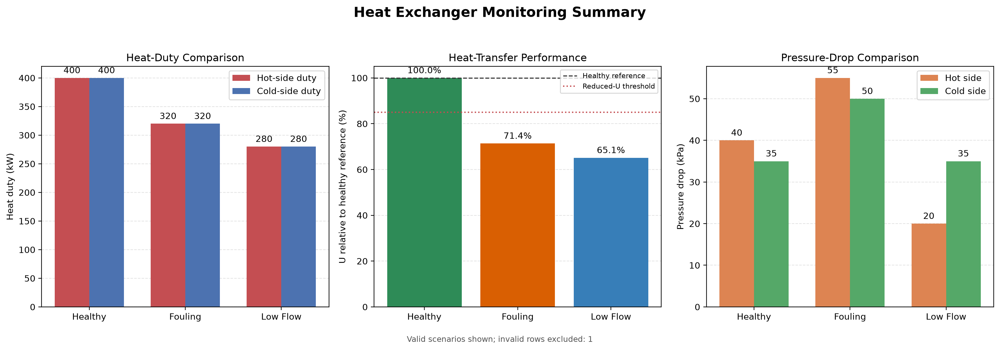
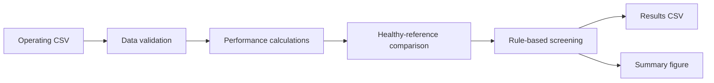

# Heat Exchanger Performance Monitoring and Rule-Based Fault Screening

An explainable Python MVP for analysing synthetic heat-exchanger operating data, calculating performance indicators, validating physical consistency, and screening possible operating faults using transparent engineering rules.



## Project status

MVP completed on 7 November 2026.

All current functionality is covered by automated tests.

## Project purpose

Heat-exchanger performance can deteriorate because of fouling, reduced flow, measurement problems, or other operating changes. Individual measurements may not provide enough evidence to distinguish these conditions.

This project combines temperature, flow and pressure measurements to:

- validate whether operating data are physically suitable for analysis;
- calculate engineering performance indicators;
- compare operation with a healthy reference;
- screen possible operating problems using explainable rules;
- export results and generate an engineering summary figure.

The project focuses on transparent engineering reasoning rather than black-box prediction.

## Workflow



## Main capabilities

- CSV loading and required-column validation
- Row-level engineering data validation
- Hot-side and cold-side heat-duty calculation
- Energy-balance deviation calculation
- Counter-current LMTD calculation
- UA and overall heat-transfer coefficient calculation
- Hot-side and cold-side pressure-drop calculation
- Healthy-reference performance comparison
- Explainable rule-based fault screening
- Command-line interface
- CSV result export
- Automated engineering visualisation
- Pytest test suite

## Engineering calculations

### Heat duty

Hot-side heat duty:

$$
Q_h = \dot{m}_h c_{p,h}(T_{h,in}-T_{h,out})
$$

Cold-side heat duty:

$$
Q_c = \dot{m}_c c_{p,c}(T_{c,out}-T_{c,in})
$$

With mass flow in kg/s and heat capacity in kJ/(kg·K), the calculated duty is in kW.

### Energy-balance deviation

$$
\text{Deviation} =
\frac{|Q_h-Q_c|}
{(Q_h+Q_c)/2}
\times 100
$$

### Counter-current LMTD

$$
\Delta T_1 = T_{h,in}-T_{c,out}
$$

$$
\Delta T_2 = T_{h,out}-T_{c,in}
$$

$$
\Delta T_{lm} =
\frac{\Delta T_1-\Delta T_2}
{\ln(\Delta T_1/\Delta T_2)}
$$

Both terminal temperature differences must be positive.

### Heat-transfer conductance and coefficient

$$
UA = \frac{Q}{\Delta T_{lm}}
$$

$$
U = \frac{UA}{A}
$$

The program reports \(UA\) in kW/K and \(U\) in W/(m²·K).

### Pressure drop

$$
\Delta P = P_{in}-P_{out}
$$

Pressure drops are evaluated separately for the hot and cold sides.

## Synthetic operating scenarios

The included dataset contains four intentionally designed cases.

| Scenario | Intended behaviour |
|---|---|
| `healthy` | Balanced duties and normal pressure drops |
| `fouling` | Reduced heat-transfer performance and increased pressure drops |
| `low_flow` | Reduced hot-side flow and reduced hot-side pressure drop |
| `bad_sensor` | Physically inconsistent temperature measurement |

These values are designed engineering examples rather than randomly generated measurements.

## Example results

| Scenario | Hot duty (kW) | Cold duty (kW) | U (W/m²·K) | Hot ΔP (kPa) | Cold ΔP (kPa) | Status |
|---|---:|---:|---:|---:|---:|---|
| Healthy | 400 | 400 | 267.1 | 40 | 35 | `normal` |
| Fouling | 320 | 320 | 190.6 | 55 | 50 | `possible_fouling` |
| Low flow | 280 | 280 | 173.9 | 20 | 35 | `possible_low_flow` |
| Bad sensor | — | — | — | — | — | `invalid_data` |

The invalid row is retained for traceability but is excluded from engineering calculations.

## Data validation

The validation layer checks:

- required columns;
- missing values;
- duplicate timestamps;
- positive mass flow rates;
- positive heat capacities;
- positive heat-transfer area;
- expected hot-side cooling;
- expected cold-side heating;
- positive pressure drops;
- positive counter-current terminal temperature differences.

Invalid rows receive an explanation in `validation_message`.

## Diagnostic logic

The screening layer uses the healthy scenario as its reference.

Current demonstration rules include:

- energy-balance deviation above 10% → `energy_imbalance`;
- reduced flow together with reduced pressure drop → `possible_low_flow`;
- reduced \(U\) together with increased pressure drop → `possible_fouling`;
- reduced \(U\) without the fouling pressure-drop pattern → `reduced_heat_transfer`;
- physically unsuitable measurements → `invalid_data`;
- otherwise → `normal`.

These rules are deliberately transparent so each result can be traced to measured and calculated indicators.

## Installation

Clone the repository:

```bash
git clone https://github.com/gashamhuseynli/heat-exchanger-monitoring.git
cd heat-exchanger-monitoring
```

Create and activate a virtual environment:

```bash
python3 -m venv .venv
source .venv/bin/activate
```

Install the dependencies:

```bash
pip install -r requirements.txt
```

## Run the application

```bash
PYTHONPATH=src python -m heat_exchanger_monitoring.cli \
  data/synthetic_operating_data.csv
```

The command creates:

```text
outputs/analysis_results.csv
outputs/monitoring_summary.png
```

A different output CSV can be selected with:

```bash
PYTHONPATH=src python -m heat_exchanger_monitoring.cli \
  data/synthetic_operating_data.csv \
  --output outputs/custom_results.csv
```

## Run the tests

```bash
PYTHONPATH=src pytest -q
```

Current expected result:

```text
17 passed
```

The test suite covers calculations, data loading, validation, analysis, diagnostics, the complete pipeline, and figure generation.

## Repository structure

```text
heat-exchanger-monitoring/
├── data/
│   └── synthetic_operating_data.csv
├── outputs/
│   ├── analysis_results.csv
│   └── monitoring_summary.png
├── src/heat_exchanger_monitoring/
│   ├── calculations.py
│   ├── data_io.py
│   ├── validation.py
│   ├── analysis.py
│   ├── diagnostics.py
│   ├── pipeline.py
│   ├── visualization.py
│   └── cli.py
├── tests/
├── requirements.txt
└── README.md
```

## Technology

- Python
- NumPy
- Pandas
- Matplotlib
- Pytest
- Git and GitHub

## Important limitations

This is an educational engineering MVP based on synthetic data.

- It has not been validated using industrial plant data.
- Diagnostic outputs indicate possible operating conditions, not confirmed equipment diagnoses.
- Thresholds are demonstration values derived from the synthetic healthy reference.
- Heat capacities are treated as supplied constants.
- The model does not calculate Reynolds, Nusselt or Prandtl numbers.
- Detailed exchanger geometry, fluid-property correlations and fouling resistance are outside the current scope.
- The current LMTD calculation assumes counter-current flow.

The results must not be used as a substitute for plant procedures, calibrated instrumentation, inspection, or professional engineering judgement.

## Possible future development

- validation using real or experimentally generated datasets;
- time-series trend monitoring;
- configurable engineering thresholds;
- exchanger-specific fluid-property models;
- Reynolds and Nusselt number calculations when geometry and fluid properties are available;
- uncertainty analysis;
- interactive dashboard;
- comparison with data-driven anomaly-detection methods.

## Author

Gasham Huseynli  
Chemical Engineering undergraduate interested in process engineering, scientific computing and industrial data analysis.
